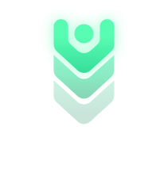

# Pandora Dee Desktop — 3.14.0

A desktop you share with Pandora Dee, Jade and their friends. It brings together the original Pandora Dee page, Jade Vault, and the atelier "desk" builds into one app you can test.

**Status:** first release, MUCH more to come!!

## Start it

You need [Node.js](https://nodejs.org) 20 or newer.

- **Windows:** double-click `Start Pandora Dee.bat`. The first run installs what it needs, then your browser opens at http://localhost:15693.
- **Mac:** double-click `Start Pandora Dee.command` (the first time, right-click it → Open, since it isn't from the App Store;
  if it won't run, `chmod +x "Start Pandora Dee.command"`). It installs on the first run and opens your browser.
- **Linux / by hand:**

```bash
npm install
npm run dev
```

Then open http://localhost:15693.

**On your phone, as an app:** reach the desktop over https and install it (Help → Install as an app, or the
browser's "Install app"). The easy https is Tailscale: on the computer running the desktop, `tailscale serve --bg 15693`,
then open `https://<computer>.<tailnet>.ts.net` on the phone (signed into the same Tailscale). Only your own devices can
reach that address. Don't use Tailscale Funnel for this: it would put the desktop, which has no sign-in, on the
public internet. Over plain http a phone can only add a shortcut.

**Moving it to another computer** (say from a Windows PC to the Mac): `git clone` the repository there, or copy the folder
without `node_modules/`, `data/` and `pdd.config.json` (those belong to the first computer), for example
`rsync -a --exclude node_modules --exclude data --exclude pdd.config.json pandora-desktop/ mac.local:pandora-desktop/`.
If `node_modules` does come along, the Mac starter notices it's from another system and reinstalls; a data folder
saved as a Windows path (F:\…) is ignored on the Mac. Your keys, chats and vault stay on the first computer unless
you move them with a backup (Settings → Backup). To reach it from a phone on the same Wi-Fi, run `npm run dev -- --host` and open the address it prints (passwords need localhost or https, so set accounts up from the computer itself).

## Give the characters a mind

The characters need a model to talk. **Settings → AI**:

- **Ollama on this computer** is set up already. Install Ollama, then for example `ollama pull qwen3:8b`, and press **Check**.
- Add more connections: Ollama Cloud, Groq, llama.cpp, LM Studio, OpenRouter, any OpenAI-compatible server, or AICord characters. They're tried in order, so if one can't be reached the next one answers.
- Each character can use their own connection and model (Characters → click a character).
- API keys go in **Keys**. Connections refer to them by name.
- Anything that isn't on this computer is blocked until you allow it in **Settings → Privacy**, after reading what it shares.

## What's here

| Window | What it does |
| --- | --- |
| **Room** | Talk with everyone in the room. Name someone to talk to them, or say "everyone". Click a face to choose who answers by default. Icons along the top: let them talk, free talk, loop breaker, voice, stop. |
| **Presence** | One shared, movable, resizable window that shows whoever is talking, like a video call. Anime faces with lip-sync to the computer's own voices. Talking, Chibi or Photo per character. |
| **Characters** | Profiles, who's in the room (up to 6), invite / step out, a model per character, save a backup, create someone new, load a backup. You can also drag a backup (.json) anywhere onto the desktop. |
| **Notes** | Your own notes: markdown files in the vault, with `[[links]]` (suggested as you type), backlinks, `#tags`, embeds, math, task boxes you can tick, frontmatter, find and replace, a graph, daily notes and templates. Renaming carries links along; deleting moves to `.trash`. Import from Google Keep, Samsung Notes, Apple Notes, Word, PDF, HTML, text or a zip. When you ask, the characters read, write, edit, search and link notes with you (never for anyone on Discord or Vector). |
| **Vector** | Vector itself, the private, encrypted messenger: **install and open Vector's own app** from here (downloaded from Vector's GitHub releases and checked against the release's checksum), with everything it offers, including signing in from your phone so your key never touches the computer. A QR code gets the Android app onto a phone. **Vector's own app inside the desktop** too, in its window and on the phones that open the desktop: Vector built from its source in host mode, with its own data folder so it runs next to any Vector you already have (see *Vector's app inside the desktop* below). Or a lighter **built-in client** in the window: your own account's direct chats and Communities, files, and Mini Apps (webxdc) that open straight into Games & Apps, or go back into a chat from there. Sign in with your key (kept in Keys on that device if you like) or make a new identity. Runs Vector's own `vector-agent` on the computer with the desktop: build it from Vector's repository (`cargo build --release -p vector-agent`) and put it in the data folder's `vector` folder. The characters' Vector accounts stay on the bridges. |
| **Browser** | Web pages in tabs: back and forward, bookmarks, a start page, search from the address bar (DuckDuckGo, or your SearXNG), and **Reader** for any page as clean text. Pages come through the desktop into a sandboxed frame that can't reach the desktop, its keys or the apps; sign-ins don't carry over, so “Open in your browser” is there for those. Pages on this computer don't open in it. |
| **Create** | **Imagine**: pictures from a picture engine you run (ComfyUI, Draw Things or Automatic1111/Forge, or an OpenAI-style image service), usually on another computer on your network, saved into the vault. A **Gallery** of the pictures and PDFs in your vault, **Paint** (miniPaint, right in the window and kept offline) that opens and saves them in the vault, and **Apps** to install and open them in: GIMP (found if you already have it), Krita and Inkscape through your package manager, and Storytold's open-source Craft apps (PhotoCraft, PdfCraft, VectorCraft, LightCraft, ArtCraft) from their GitHub releases, checked against each release's SHA-256. Right-click a picture to choose where it opens. |
| **Music** | **Make a song**, the Suno/Udio way: describe it and a character writes the title, style and lyrics, or write them yourself (style chips, section tags), pick the length, and a song engine makes it: MLX Audio on a Mac through `scripts/mlx-music-bridge.py` (MiniMax Music 3 and other mlx_audio.music models), mlx-serve / MLX Core (MiniMax Music 3, ACE-Step 1.5 XL), ACE-Step 1.5's own API, or YuE2 through ComfyUI. You choose the model; none is shipped, with no ComfyUI screens to deal with. Songs land in your library, with Remix and their words kept. Your music folders (read where they are, subfolders and folder links too, picked with Browse… or typed) and files you add, Shuffle all, Shuffle albums (each album played through) and Shuffle artists (each one's albums in order), internet radio from radio-browser.info, a **Worldband** map of about 5,000 stations to tune by clicking, sweeping a dial or scanning, a queue with shuffle and repeat, and visualizers: bars, a scope, or Milkdrop (Butterchurn, with presets you can import), in Music, in their own resizable window, full screen, or as the desktop background. Music lowers itself while a character speaks. Characters can play, pause, skip and queue for you, and (if you turn it on) say something when a new song starts, after listening to it for a few seconds. |
| **Files** | Each character's own files. SOUL.md (who they are), AGENTS.md (how they carry themselves) and MEMORY.md are read at the start of every conversation, so editing them changes the character. |
| **Journal** | Each character's quest journal and memory. "Write today's entry" and "Reflect into memory" ask the character to do it in their own voice. |
| **Terminal** | A shell over a character's files (`help` lists the commands). `ask` talks to the character privately. |
| **Games & Apps** | 51 built-in games, over twenty webxdc apps shared by the Vector community to play and build on together (chess, Gomoku, MachStrike, Vexel, Strudel, Arcane Dungeon, Telengard and more; see NOTICE), plus your own Vector apps. Sections, search, sort, and four views (big tiles, cards, details list, compact). Every version of an app stays installed: pick which one Play opens, play any other, and choose whether versions share their game state. Import single `.xdc` files, a `.zip` of them, or a folder (drag and drop works too); identical files are kept once. Characters can play along: they read the screen, read the app's shared state, and send their own moves. |
| **XDC Studio** | Open any version of a Vector app and look inside. Imported versions stay untouched; "New version" makes an editable copy, which you can change here or in your own editor (its folder is shown), run, and save as `.xdc`. "New app from a template" starts a working multiplayer app. |
| **Hangout** | The scene on its own: the characters stand in it (talking bust, chibi, photo, or a full avatar: Live2D, VRM 3D, or an animated picture, with lip-sync; right-click a character to switch, and add avatars in their profile; with speech bubbles), wander a little, and can be dragged around. A slim chat bar and a few recent lines sit at the bottom; the rest of the desktop steps aside. Dock button, View → Hangout, or Ctrl/⌘+Shift+H; Esc comes back. They can also stand on the normal desktop behind the windows. Right-click the scene to choose the chat: the conversation (whole replies, scrolling) and the typing bar, only the bar, or none (Enter still opens the bar). |
| **Voice** | Replies read aloud with this computer's voices, or a voice engine you run: MLX Audio on a Mac (Kokoro's voices), OpenAI, or any server with OpenAI's speech API, with a voice per character and lips that follow the audio. Talk instead of typing with the 🎤 button in the Room and Hangout (Whisper through the same engine; phones need the https address). If an engine can't be reached, this computer's voices take over. |
| **Connections** | Everything that reaches past this computer, matching Pandora Dee and Jade Vault. **Discord and Vector** through their existing bridges: you (their locksmith), admins and the public each get what Classic gives them (people who aren't you never see your memory or files), trigger words, DM rules, pictures, Mini Apps, community invites, the Discord archive. **Inbox**: the secretary files messages for you. **Tool servers (MCP)**: direct, deferred, codemode or hidden, per server and per tool, resources, and mcp.json in and out. **Web**: Ollama web search, SearXNG, DuckDuckGo or Wikipedia. **SSH** to your own machines, with key approval and ask-before-commands. **Inbound API**: Classic's `/v1` routes for scripts and other apps. |
| **Sentry** | The flood gate (on by default) and the device watch (off by default; needs Privacy permission plus the adult passcode or shelf). |
| **Keys** | API keys and tokens, like environment variables. Never shown again, never in backups. |
| **Settings** | AI, look (text size, scale, wallpaper, menu bar), voice, privacy, accounts, adult shelf, backup and reset. |
| **Classic** | The original apps, unchanged: Pandora Dee 2.9.9.2 (and 2.9.0) and Jade Vault 2.18.2, built from their latest sources. The round button in the corner switches app and version or returns to the desktop (Ctrl/⌘+Shift+K). Each app keeps its own notes and settings. |

### The dock, keyboard and touch

- The dock can sit on any edge (drag its grip, or right-click it), hide until needed, show names, and hold whichever apps you choose in any order (Settings → Dock).
- Every desktop action has a shortcut you can change (Settings → Keyboard). Shortcuts with Ctrl/⌘+Shift work even while a game has the keyboard.
- Touch: tap a character to have them answer, drag them around, hold for options; double-tap the empty desktop for Hangout; swipe in from the edge for a hidden dock (Settings → Touch).

### Where things are kept

Vector apps and their saved game state live in a folder (Settings → Storage). Apps run on `127.0.0.1` while the desktop runs on `localhost`: two separate origins, so an app can never read the desktop's keys. Apps also can't reach the internet, as the webxdc standard requires. Characters, settings and the conversation live in the browser.

### What characters can do (tools)

With a model that supports tools (qwen3, llama 3.1+, gpt-oss, mistral…): list, read, write, append and search their own files; remember things; write their journal; read the open game's screen; read a Vector app's shared state and send their own updates and live messages (so they can join XDC-Chess as a real peer); post on Discord or Vector when connected; any tool from connected MCP servers; and, if Privacy allows web access, search the web, read pages, and call web APIs using `{{KEY_NAME}}` from Keys without seeing the key.

On Discord and Vector, only you (the locksmith: the id you set) get the tools; everyone else just talks.

### Safety pieces

- **Privacy:** None (default: nothing leaves the computer), Some (opt in feature by feature after reading the risk), or Conditional (like Some, only during hours you choose). The top bar always says "Local only" or that something is going out.
- **Streamer mode:** hides the names and/or messages of people coming in from Discord and Vector, plus anyone on the always-anonymous list. The characters stay on screen.
- **Flood gate:** 6 messages in 20 seconds, the same message 3 times, one huge message, or several large ones shut the gate. The characters stop and general access is off until the keyholder reopens it.
- **Loop breaker:** stops repeats, and waits for you after 6 character replies in a row. Off, it still stops at 16.
- **Accounts:** optional. The first account holds the keys. No password (the picture opens it) or a password (salted hash only), with "Always remember".
- **Adult shelf:** the desktop starts in family mode. Adult characters stay hidden until unlocked with the passcode, and it locks again with the desktop.

Everything is stored in your browser on your computer. **Settings → Backup and reset** saves or restores the whole desktop (without keys, passwords or the passcode), and can back up on a schedule to your own server (Jade Vault's `jade-backup-server.py`), encrypted on your computer first.

## For developers

```bash
npm test        # logic tests (flood gate, room, loop breaker, shell, privacy, backups, xdc manifests)
npm run build   # typecheck and build to dist/
```

`server/` is the local server Vite runs (`/api` for the library and game state, `/run` for apps on the app origin). `scripts/classic.mjs` installs a new Classic build (`node scripts/classic.mjs pandora|jade <built.html> <version>`); `scripts/cutout.py` makes the transparent character cut-outs used in Hangout.

Code map: `src/lib` is the logic (store, model connections, agent loop, tools, MCP client, bridges, privacy, flood gate, shell, voice); `src/apps` is one file per window; `src/ui` is the desktop, windows, menus and lock screen. `public/classic/pandora-dee.html` is the original page, untouched.

### Vector's app inside the desktop

The Vector window can show Vector's own app: its interface, served by the desktop, and its engine, running hidden on the computer with the desktop. It's Vector built from its source with a small host mode added (`vector-host/`): with its own identifier and data folder (`<data folder>/vector-host`), it never touches the data, the single-instance lock or the `vector://` links of a Vector you already have. The desktop starts it when the window opens; its bridge talks only to this computer, with a token made for each run. File pickers use the browser's own (the file goes to the desktop, then to Vector); folders, saving to a chosen place and Vector's updater aren't available there, so update by rebuilding.

```bash
node vector-host/build.mjs --vector <checkout of github.com/VectorPrivacy/Vector> --out <data folder>/vector-host/app
```

It needs Node, Rust, and on Windows Microsoft's C++ build tools. Without Visual Studio (or room on C:), [portable MSVC](https://gist.github.com/mmozeiko/7f3162ec2988e81e56d5c4e22cde9977) unpacks Microsoft's compiler and SDK into any folder: pass it with `--msvc <folder>`. `--target` and `--cargo-home` put the build (5–10 GB) and cargo's downloads on another drive. It builds without Whisper and Tor, with lighter optimization than Vector's releases.

Original characters are shared under the AETHER-ENGINEERS Multiversal License. Jade and Jade Vault are their creator's work. Games by SunkissedButterfly (websim.ai).

## 💬 Contact us

<a href="https://vectorapp.io/profile/npub1vrte0qmajxq7f805h02s2lle9q9czpcnzezasf8eydnz3mk63ansrwzk8p"></a>

**Come say hi on Vector Messenger** ✨<br/>
Questions, ideas, bug reports, or just to chat with the team (Pandora Dee hangs out on Vector too).<br/>
👉 **[Message us on Vector](https://vectorapp.io/profile/npub1vrte0qmajxq7f805h02s2lle9q9czpcnzezasf8eydnz3mk63ansrwzk8p)**

<br clear="left" />

<sub>New to Vector? It's a private, encrypted messenger: get it at <a href="https://vectorapp.io">vectorapp.io</a>. Vector and its logo are trademarks of Formless Labs, used here to link to Vector.</sub>

